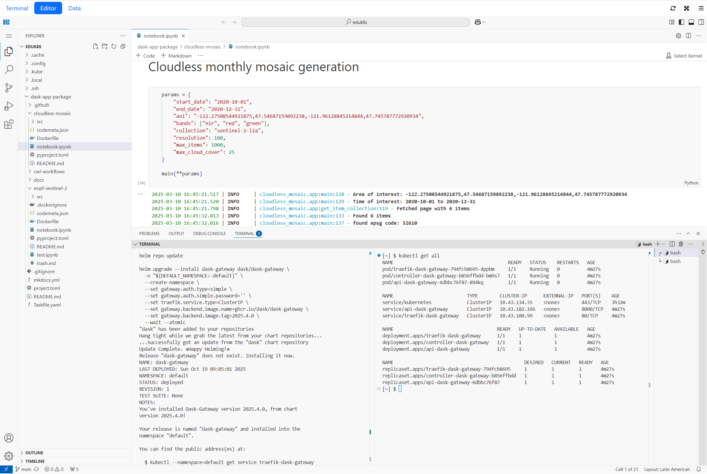

<h1> Provider Datalab</h1>

[](https://github.com/versioneer-tech/provider-datalab/actions/workflows/pr.yaml)
[](https://github.com/versioneer-tech/provider-datalab/pkgs/container/provider-datalab)
[](LICENSE)

> [!NOTE]
> From Datalab 0.12.0, the package path changes from
> `ghcr.io/versioneer-tech/provider-datalab/educates`
> to `ghcr.io/versioneer-tech/provider-datalab`.

Provider Datalab is a Crossplane configuration package for shared data
workspaces. A team requests storage access, compute sessions, and managed
services through one `Datalab` resource.

```yaml
apiVersion: pkg.internal/v1beta2
kind: Datalab
metadata:
  name: s-jeff
  namespace: workspace
spec:
  users:
  - jeff
  - jim
  - jane
  databases:
    pg0:
      names:
      - dev
      - prod
      storage: 1Gi
      backupStorage: 3Gi
```

The platform operator sets identity, network, storage, and security rules.

Educates provides a browser editor, terminal, and persistent session workspace.
The shared Data service, packageR, lets users browse and share object storage.
Datalabs can also request PostgreSQL, MongoDB, and Redis stores.

The integration tests use Crunchy PGO `6.0.2`, MongoDB Kubernetes
Operator `1.14.0`, and Opstree Redis Operator `0.27.0` (Helm chart `0.27.0`).
See the [operator prerequisites](docs/how-to-guides/installation.md#prerequisites)
for the required resource APIs.



## Documentation

- [Installation](docs/how-to-guides/installation.md): prerequisites, setup, and all EnvironmentConfig values and defaults.
- [Use a Datalab](docs/how-to-guides/usage_concepts.md): sessions, stores, and file sharing.
- [Examples](examples/base): complete Datalab manifests.
- [Authentication](docs/how-to-guides/authentication.md): Keycloak roles and session ingress protection.
- [S3 client access](docs/how-to-guides/s3-access.md): read data with AWS tools.
- [Additional services](docs/how-to-guides/additional_services.md): run Dask, MLflow, or psql from a workspace.
- [Security](docs/security/index.md): access rules and operator responsibilities.
- [API reference](docs/reference-guides/api.md): Datalab fields and service types.

The documentation is also [published online](https://provider-datalab.versioneer.at/).

## Local checks

Docker must be running for the render tests:

```bash
python3 -m pip install -r scripts/requirements.txt
python3 scripts/build-composition.py
bash tests/unit.bash
pre-commit run --all-files
```

Edit the Python steps in `composition/` and the manifests in `templates/`.
See [Manifest templates](templates/README.md) for the source layout and build.

`composition/settings.yaml` sets one response TTL for all pipeline steps.
The default is `5m`. See the [installation guide](docs/how-to-guides/installation.md)
for package setup.

See [Unit tests](tests/README.md) for fixtures and focused checks, and
[Integration tests](tests/integration/README.md) for the dedicated Kind cluster.

## License

[Apache License 2.0](LICENSE).
