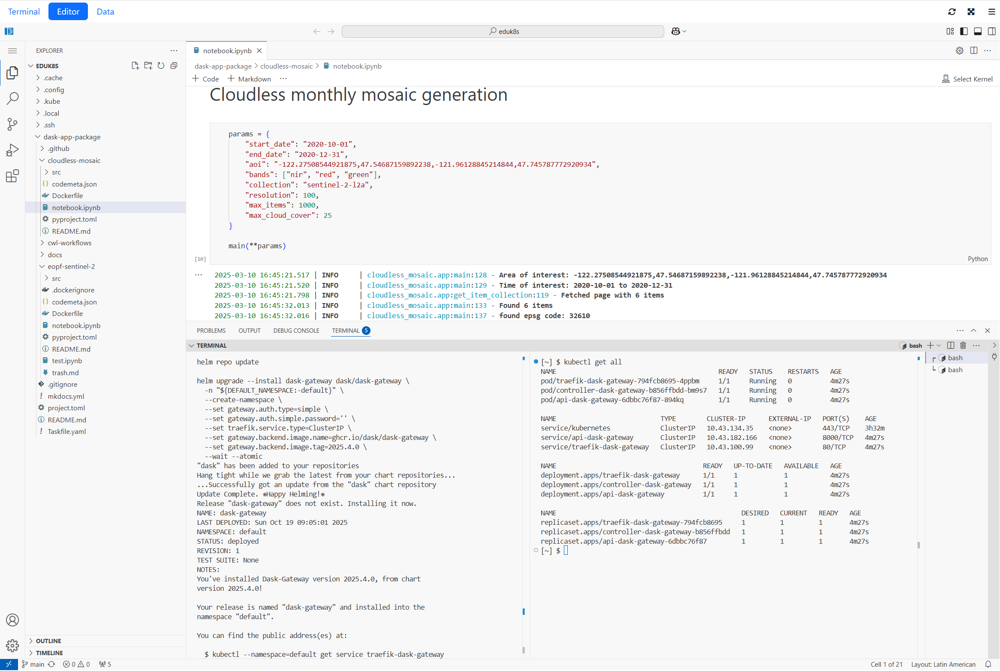

<h1> Provider Datalab</h1>

[](https://github.com/versioneer-tech/provider-datalab/actions/workflows/pr.yaml)
[](https://github.com/versioneer-tech/provider-datalab/pkgs/container/provider-datalab%2Feducates)
[](LICENSE)

Provider Datalab is a Crossplane configuration package for shared data
workspaces. A team requests storage access, compute sessions, and managed
services through one `Datalab` resource. The platform operator sets the
identity, network, storage, and security rules.

The Educates runtime provides a browser editor, terminal, and persistent
workspace for each session. The shared Data service, packageR, lets users
browse object storage and share files without a running session. PostgreSQL,
MongoDB, Redis, Qdrant, and a Docker registry are optional.



## Get started

Install Crossplane and the required controllers, apply the provider
dependencies, and set the shared `EnvironmentConfig`. Follow the
[installation guide](docs/how-to-guides/installation.md) for these steps.
Object storage and its credentials must exist before you create a Datalab.
[Provider Storage](https://provider-storage.versioneer.at/) can supply them.

This example requests a workspace for Alice:

```yaml
apiVersion: pkg.internal/v1beta2
kind: Datalab
metadata:
  name: demo
  namespace: workspace
spec:
  users:
  - alice
  sessions:
  - name: default
```

Alice must exist in the configured Keycloak realm. The default session starts
with an editor, terminal, and its own workspace PVC. The operator must protect
session ingress. See [Authentication](docs/how-to-guides/authentication.md)
for the NGINX and APISIX examples.

## Add services

Add the services a team needs to the same resource:

```yaml
spec:
  databases:
    pg0:
      names:
      - analytics
      storage: 1Gi
      backupStorage: 3Gi
  documentStores:
    prod:
      storage: 1Gi
  cacheStores:
    prod:
      storage: 1Gi
  vectorStores:
    prod:
      storage: 1Gi
  registry:
    enabled: true
    storage: 3Gi
```

Each managed store needs its operator installed. The platform team manages
backups, monitoring, upgrades, and deletion. See the
[usage guide](docs/how-to-guides/usage_concepts.md) for session state, Data
sharing, storage, and security settings. Complete examples are in
[examples/base](examples/base).

## Documentation

- [Installation](docs/how-to-guides/installation.md): platform setup and shared settings.
- [S3 client access](docs/how-to-guides/s3-access.md): read data with AWS tools.
- [Additional services](docs/how-to-guides/additional_services.md): run Dask, MLflow, or psql from a workspace.
- [Security](docs/security/index.md): access rules and operator responsibilities.
- [API reference](docs/reference-guides/api.md): all resource fields.

The documentation is also [published online](https://provider-datalab.versioneer.at/).

## Local checks

Docker must be running for the render tests:

```bash
bash tests/unit.bash
pre-commit run --all-files
```

See [Integration tests](tests/integration/README.md) for the dedicated Kind
cluster and test profiles.

## License

[Apache License 2.0](LICENSE).
